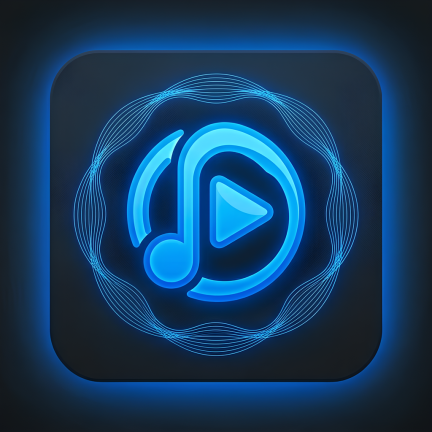
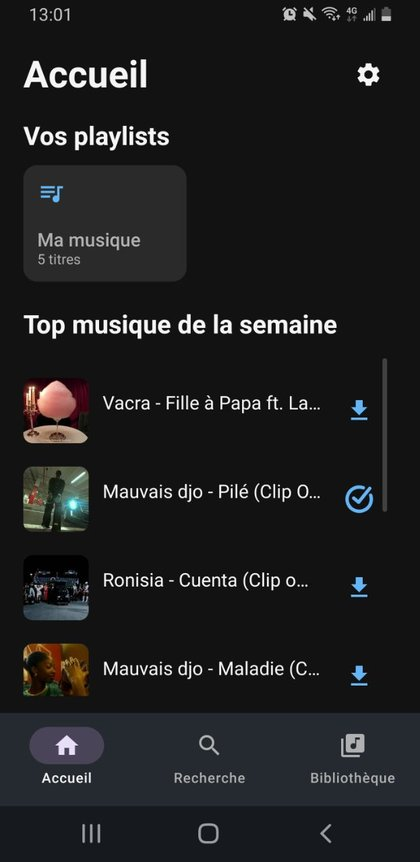
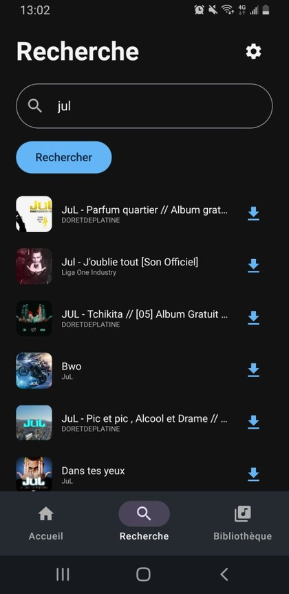
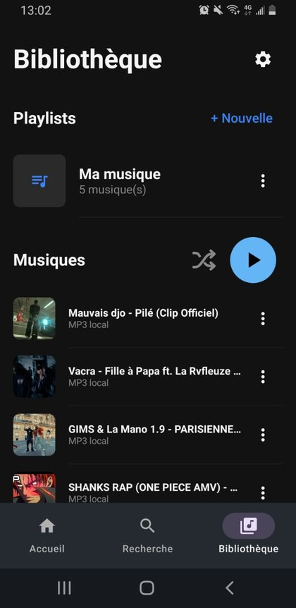
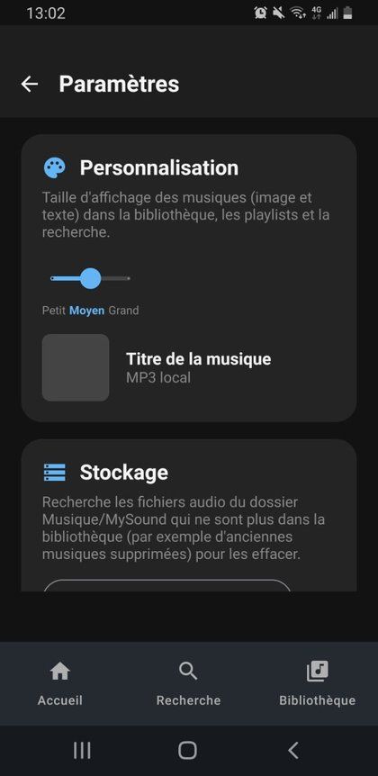

# MySound

**Ta musique, ton univers.**
Recherche, télécharge et écoute tes musiques, même sans connexion.

---

## 📱 Aperçu

<table>
  <tr>
    <td align="center"> <b>Accueil</b> Playlists et top de la semaine</td>
    <td align="center"> <b>Recherche</b> Résultats issus de YouTube</td>
    <td align="center"> <b>Bibliothèque</b> Tes musiques et tes playlists</td>
  </tr>
</table>

## ✨ Fonctionnalités

- 🔎 **Recherche musicale** : trouve un titre ou un artiste, les résultats proviennent de YouTube.
- ⬇️ **Téléchargement** : télécharge tes musiques directement depuis l'application (MP3 local).
- 📴 **Écoute hors ligne** : tes morceaux téléchargés restent disponibles sans connexion.
- 🏆 **Top musique de la semaine** : un classement hebdomadaire basé sur YouTube Music, affiché sur l'accueil.
- 🎶 **Playlists** : crée tes propres playlists et retrouve-les facilement.
- 🔀 **Lecture aléatoire** : mélange ta bibliothèque en un clic.
- 📻 **Radio** : change d'ambiance et découvre d'autres sons.
- 🎨 **Personnalisation** : règle la taille d'affichage des musiques (petit, moyen ou grand) dans la bibliothèque, les playlists et la recherche.
- 🧹 **Gestion du stockage** : supprime les anciens fichiers audio du dossier `Musique/MySound` qui ne sont plus dans ta bibliothèque.
- 💡 **Boîte à idées** : propose des améliorations directement depuis l'application.

## 🎨 Personnalisation

Un simple curseur permet d'adapter l'affichage des musiques (image et texte) à tes préférences, avec un aperçu en direct dans les paramètres.

## ⬇️ Installation

1. Télécharge le fichier **[MySound.apk](https://github.com/maelmo248/MySound/releases/download/v1.0/MySound.apk)** sur ton téléphone Android.
2. Ouvre le fichier. Si Android te le demande, autorise l'installation depuis cette source.
3. Lance **MySound** et profite de ta musique !

Toutes les versions sont disponibles dans l'onglet [Releases](https://github.com/maelmo248/MySound/releases).

## 🌐 Site web

Retrouve la présentation de l'application sur **[justchilll.ddns.net/mysound](https://justchilll.ddns.net/mysound)**. Tu peux aussi y proposer tes idées d'amélioration.

## 🤝 Contribuer

Une idée, un bug, une envie de fonctionnalité ? Ouvre une [issue](https://github.com/maelmo248/MySound/issues) ou envoie ton message via le formulaire du site ou de l'application.

---

Fait avec ❤️ pour les passionnés de musique.

